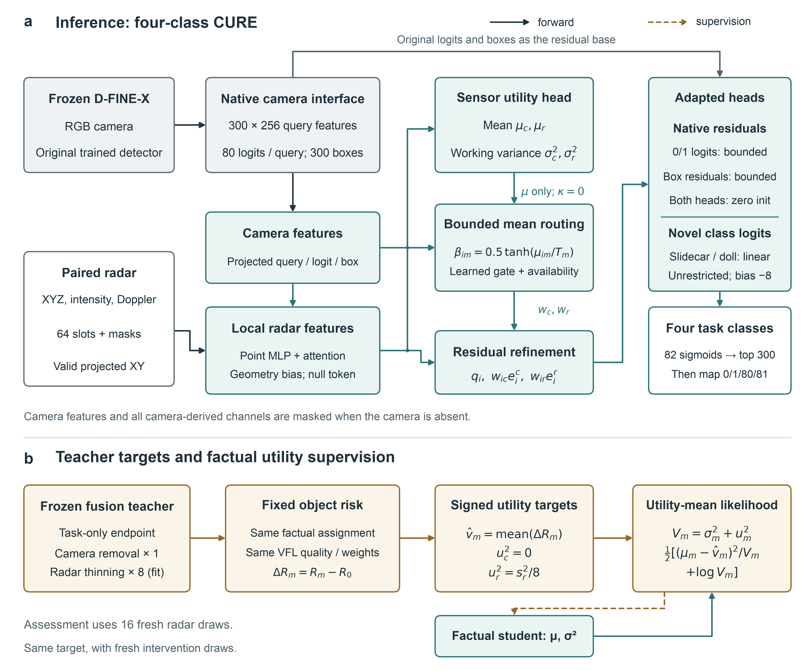
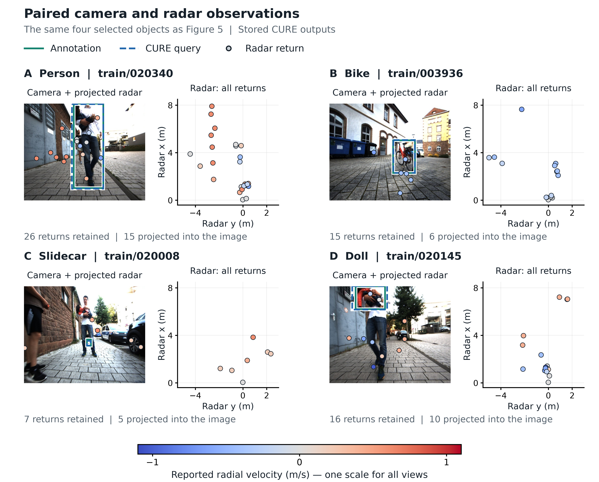

# CURE-Fusion

### CURE-Fusion: Studying the Gap Between Sensor Attribution and Routing in Multimodal Detection

[Getting started](SETUP.md) · [Figures](figures/README.md) · [Results](tables/README.md) · [Model code](code/cure_fusion/dfine_cure_v3.py)

**How much does a sensor contribute to a detection—and does that tell us how to use it?**

**CURE** stands for **Counterfactual Utility Reasoning**. CURE-Fusion is the camera–radar framework used in this study. It estimates **Counterfactual Sensor Utility (CSU)**, a signed measure of how a frozen teacher's object-level loss changes when a modality is removed or perturbed. It combines a camera–radar detection interface, learned utility estimates and a bounded residual controller to examine the relationship between sensor attribution and routing decisions.

<p align="center"></p>

## Research contributions

- **Controlled sensor attribution.** Factual object assignment, classification-quality targets and risk weights are held fixed when forming utility targets, making the loss comparison explicit.
- **Learned object-level utility.** Utility readouts estimate the signed contribution of camera and radar inputs, with comparisons against fitting constants and trained feature readouts.
- **Attribution versus action.** Matched controllers, action-selection studies and a mathematical counterexample distinguish dependence on a sensor from the benefit of changing a routing decision.
- **Camera–radar analysis.** Real paired observations connect the formulation to detection outputs, class-level behavior and computational cost.

## Camera and radar together

<p align="center"></p>

Four recorded scenes show the paired inputs used in the analysis. These are qualitative examples; aggregate comparisons are reported separately. All eight figures are available as [PNG, PDF and SVG](figures/README.md).

## Main findings

On 2,521 objects from eight reused development recordings, camera-utility RMSE is **7.66% lower** than a trained readout on task-only features and **44.99% lower** than a fitting-mean constant. These are post-hoc utility-prediction comparisons, not detection improvements; the feature comparison also changes factual query correspondence.

The separately declared fitting-scale correction was refitted across five adapter-training seeds (11, 23, 37, 53 and 71). Each arm shares one frozen D-FINE-X visual detector and all CURE seeds share one archived task-only teacher.

| Matched detector | Clean COCO box AP (%), mean ± sample SD |
| --- | ---: |
| Task-only | 62.93 ± 0.69 |
| CURE-Fusion | 62.28 ± 0.45 |
| Modality dropout | 62.85 ± 0.93 |

CURE is lower in every paired clean comparison; the mean CURE-minus-task-only difference is −0.65 ± 0.73 AP points. Unsaturated camera biases are observed in the declared fitting diagnostic (258 objects per seed), without an added matched detection benefit. These are adapter-seed summaries on eight reused recordings, not population confidence intervals. The original utility-readout, action and timing studies remain separate. See [all results](tables/README.md) for eighteen tables and every condition.

## Getting started

The CPU example below runs the saved utility analysis and generates the scientific tables. It needs no GPU, dataset download or trained checkpoint.

```sh
git clone https://github.com/isaacodaf/CURE-Fusion.git
cd CURE-Fusion
python3.12 -m venv .venv
source .venv/bin/activate
python -m pip install -r requirements.txt
python reproduce_results.py --skip-figures --output outputs/quickstart
```

Open `outputs/quickstart/REPRODUCTION.json` for the check result and `outputs/quickstart/tables/` for the outputs. Use a new output directory for each run.

**[SETUP.md](SETUP.md)** covers installation, tests, figure generation, evaluation of saved detections, CUDA experiment requirements and troubleshooting. Full training requires the external data, caches and checkpoints listed there.

## Training and detection evaluation

To repeat training and detection evaluation, readers also need the relevant datasets, pretrained model weights and saved detector features described below. These inputs are separate from the small saved-result examples included here.

| Input | Source and use |
| --- | --- |
| SEW Multimodal AMR Dataset 2025 | Obtain camera images, paired radar observations and annotations from the [dataset authors](https://github.com/SEW-Eurodrive-Open-Source/Multimodal_AMR_dataset). The detector experiment uses the supplied [split manifest](configs/execution/metadata/004_SPLITS_V1.json): 6,180 fitting frames and 992 inner-development frames. |
| Pretrained detector weights | Use the matching [D-FINE](https://github.com/Peterande/D-FINE) weights for the frozen camera features. The separate native-fitting experiment uses [RT-DETR](https://github.com/lyuwenyu/RT-DETR). Match the upstream revision and checkpoint SHA-256 in [external_dependencies.json](configs/external_dependencies.json); another checkpoint is not interchangeable. |
| Saved detector features | The detector launcher reads the complete 7,172-frame feature cache, including its array chunks, labels, `REPORT.json`, `protocol.json`, `selected_records.json` and `ARTIFACT_HASHES.json`. This cache contains frozen detector outputs and paired radar inputs. |
| Training prerequisites | The detector launcher also requires its four-class CUDA admission report, which records the prerequisite supervised-step checks. Later utility/action experiments require the corresponding trained checkpoints and feature banks listed in [the dependency specification](configs/external_dependencies.json). |
| Detection evaluation inputs | Complete COCO ground-truth and prediction JSON files, with matching image IDs, four task categories and verified file hashes. Evaluating these saved files needs neither CUDA nor image/feature loading. |

**Input availability:** full datasets, model weights, feature caches, detector admission reports and complete prediction exports are not bundled in this repository. Public dataset and model links are given above; study-specific caches and detector reports must be obtained separately. The compact release does not include the feature-extraction/admission launchers, so downloading the dataset and weights alone is not sufficient to run the recorded detector experiment.

### Original single-seed controls

Check the packaged source and protocol first:

```sh
python run_experiment.py --experiment detector --check-only
```

Once the external cache and admission report are available, use an A100 CUDA environment with the required PyTorch, NumPy, SciPy and pycocotools dependencies. Replace every `/absolute/path/...` and `REPLACE_WITH_...` value below with your verified input. The output parent directory must exist, have at least 15 GiB free, and contain no previous run at the selected output path.

```sh
python run_experiment.py --experiment detector \
  --python /absolute/path/to/cuda-environment/bin/python -- \
  --cache /absolute/path/to/complete_feature_cache \
  --cache-report-sha256 REPLACE_WITH_CACHE_REPORT_SHA256 \
  --admission-report /absolute/path/to/four_class_admission_REPORT.json \
  --admission-report-sha256 REPLACE_WITH_ADMISSION_REPORT_SHA256 \
  --output /absolute/path/to/new_detector_run
```

The wrapper supplies the included protocol automatically. The launcher trains the matched task-only, modality-dropout and CURE arms, generates utility targets, and evaluates the completed endpoints. It writes checkpoints, logs and evaluation outputs under the selected output directory. The underlying camera detector is frozen in this study; the command trains the fusion components on its saved features. See [SETUP.md](SETUP.md#6-prepare-a-cuda-experiment) for the other experiment entry points and runtime specifications.

### Completed five-seed matched study

The unchanged frozen protocol, model source and fitting targets for the completed study are included. The command below repeats its full training and evaluation matrix when the complete feature cache and original task-only teacher checkpoint are available. Use a new output path; do not select checkpoints by development AP.

```sh
python run_experiment.py --experiment matched-controller --check-only
python run_experiment.py --experiment matched-controller \
  --python /absolute/path/to/cuda-environment/bin/python \
  --teacher-checkpoint /absolute/path/to/original_task_only_teacher.pt -- \
  --phase supervise --workers 5 \
  --cache /absolute/path/to/complete_feature_cache \
  --output /absolute/path/to/new_matched_run
```

The recorded environment used an A100-SXM4-80GB, PyTorch 2.11.0+cu130, CUDA 13.0 and FP32 with TF32 disabled. There are 15 endpoints, 600 complete epochs and 58,200 total optimizer updates. The global training barrier precedes every detection evaluation. Runtime admission checks and protocol-bound input hashes must pass.

The original task-only adapter checkpoint is an external input and must match the SHA-256 in [matched_controller.json](configs/execution/matched_controller.json). The visual detector weights and full feature cache also remain external. The wrapper checks the provided checkpoint and reconstructs the original source layout without adding internal work folders to the repository.

The compact results include verified endpoint summaries and all five CURE utility observations. `reproduce_results.py` checks those utility calculations and seed summaries locally; it does not rerun COCO AP without complete prediction exports. Independent saved-artifact replay of all 60 exports passed in the recorded study. Full predictions, fresh teacher arrays and all training chains are separate research artifacts, bound to the hashes in the recorded evaluation reports.

### Evaluate complete saved detections

```sh
python -m pip install -r requirements-evaluation.txt
mkdir -p outputs
python evaluate_saved.py \
  --ground-truth /absolute/path/to/ground_truth_coco.json \
  --ground-truth-sha256 REPLACE_WITH_GROUND_TRUTH_SHA256 \
  --predictions /absolute/path/to/predictions_coco.json \
  --predictions-sha256 REPLACE_WITH_PREDICTIONS_SHA256 \
  --output outputs/coco_metrics.json
```

Use a new output filename. Ground-truth categories must have IDs `1, 2, 3, 4`, corresponding to person, bicycle, slidecar and doll; boxes use COCO pixel coordinates `[x, y, width, height]`. This command runs pycocotools on every supplied image and returns AP over IoU 0.50–0.95, AP50, AP75 and per-class AP as fractions. Multiply by 100 to express percentages. Fixed four-class AP is unavailable if any class has no evaluation support.

To calculate a file's SHA-256 on any supported platform:

```sh
python -c "import hashlib,pathlib,sys; print(hashlib.file_digest(pathlib.Path(sys.argv[1]).open('rb'),'sha256').hexdigest())" /absolute/path/to/file
```

For recorded study inputs, compare these digests with their supplied manifests before launching; calculating a hash alone does not establish that an input is the correct study file.

## Code organization

| Directory | Contents |
| --- | --- |
| [code/cure_fusion/](code/cure_fusion/dfine_cure_v3.py) | Detector adapters, utility objectives, readouts and routing rules |
| [code/scripts/](code/scripts/train_dfine_cure_development_cuda_v2.py) | Experiment launchers |
| [configs/](configs/external_dependencies.json) | Protocols, splits and dependency specifications |
| [analysis/](analysis/utility_metrics.py) | Utility metrics and recording-level statistics |
| [plotting/](plotting/architecture.py) | Figure generation |
| [results/](results/table_views.json) | Scientific result operands and attributed sensor examples |
| [figures/](figures/README.md) | Eight finished figures |
| [tables/](tables/README.md) | Eighteen tables and full-precision results |
| [tests/](tests/test_research_release.py) | Numerical and package checks |

The scientific implementation retains the original `cev_*` tensor names; the paper uses CSU for the corresponding sensor-utility formulation. [SOURCE_MAP.json](SOURCE_MAP.json) records source identities.

## Acknowledgments and data

The detector interfaces build on [D-FINE](https://github.com/Peterande/D-FINE) and [RT-DETR](https://github.com/lyuwenyu/RT-DETR). Camera–radar examples come from the [SEW Multimodal AMR Dataset](https://github.com/SEW-Eurodrive-Open-Source/Multimodal_AMR_dataset). Please retain the applicable upstream and dataset attributions. [NOTICE.md](NOTICE.md) describes the separate dataset-example terms and project-code licensing status.
